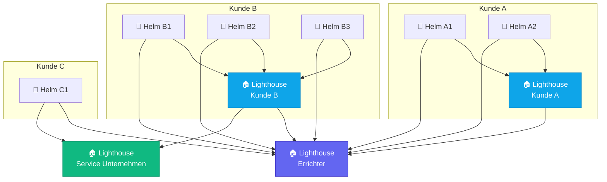
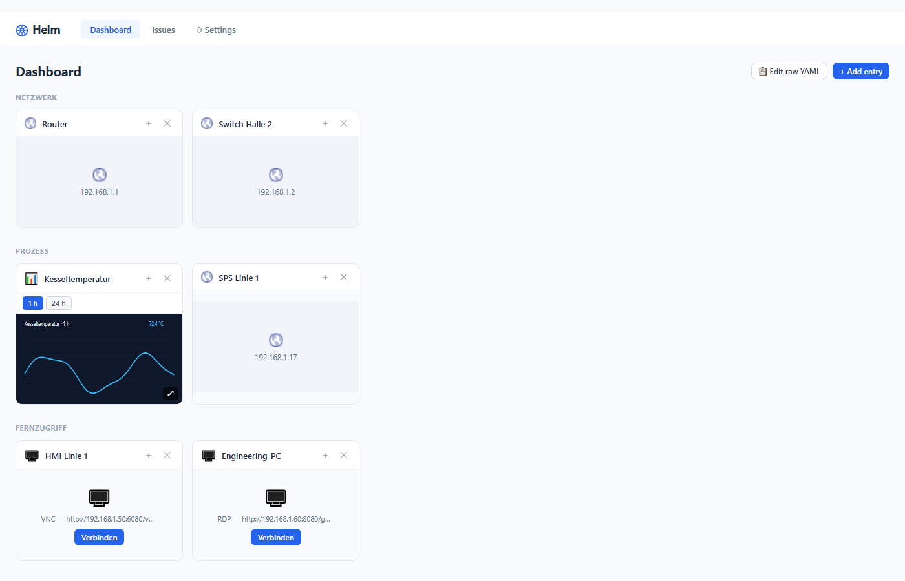
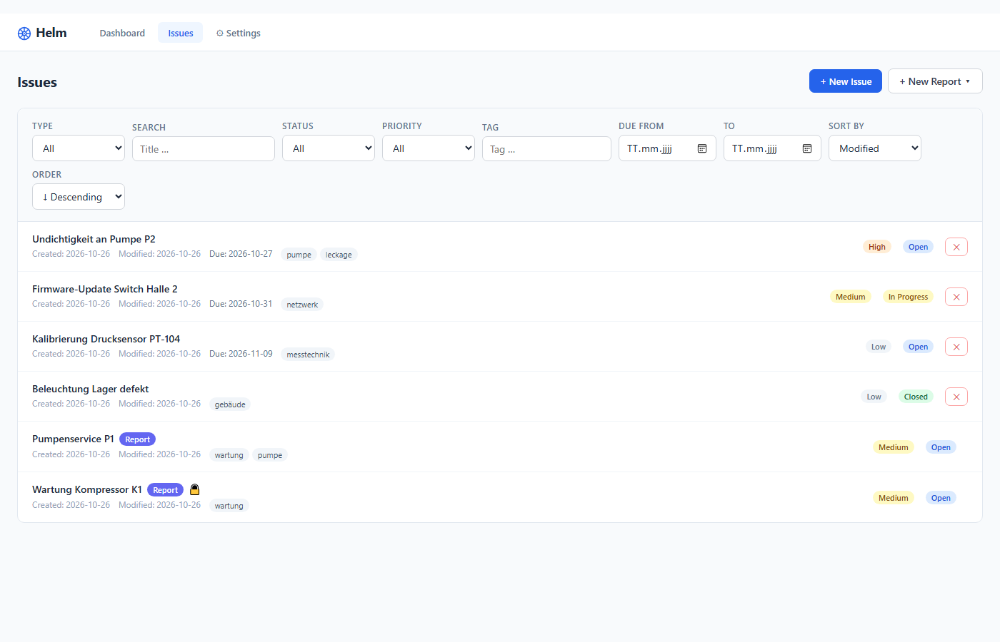
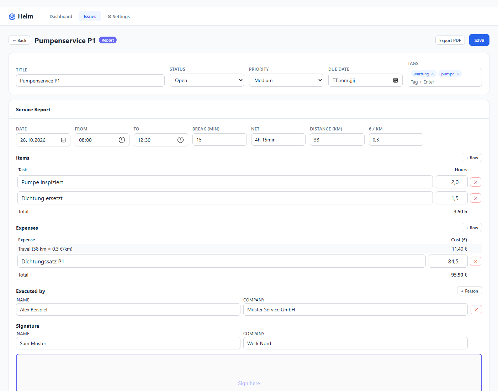
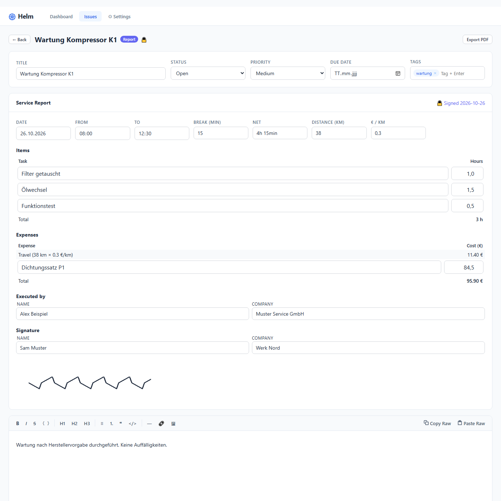
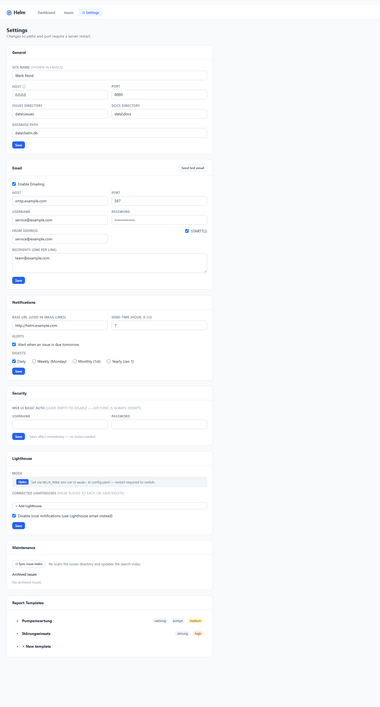
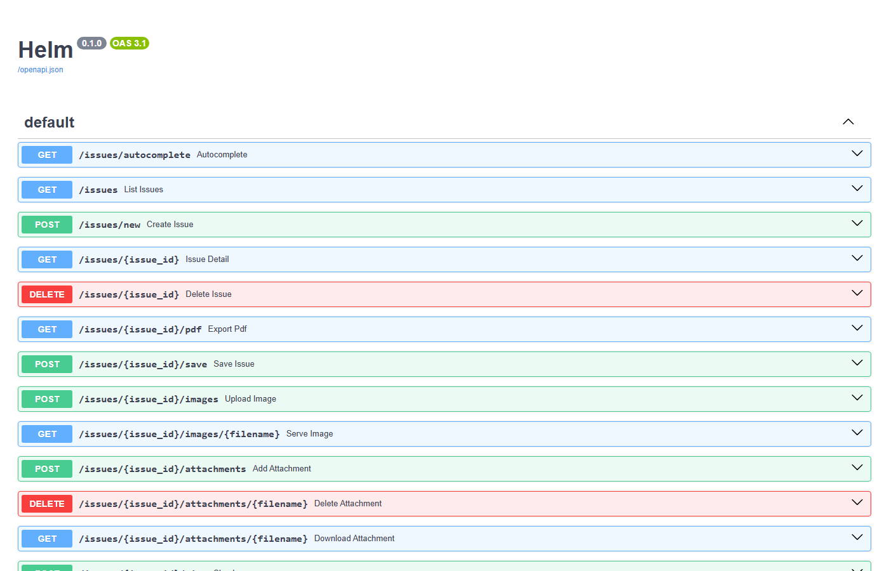

---
{}
---

# Helm / Lighthouse

**Helm** ist eine selbst-gehostete Webanwendung zur Verwaltung von Geräte-Links, Aufgaben und Serviceberichten.  
**Lighthouse** ist der dazugehörige Zentralserver, der mehrere Helm-Instanzen aggregiert und synchronisiert.
Beide Anwendungen teilen sich __eine__ Code-Basis und __ein__ Look'n'Feel

---

## Architektur auf einen Blick

```
┌─────────────────┐        HTTPS / Bearer Token          ┌──────────────────────┐
│   Helm (Client) │ ──── Issues + Dashboard push ──────▶ │ Lighthouse (Server)  │
│   Port 8081     │ ◀─── Geaenderte Issues pull ──────── │  Port 8082           │
└─────────────────┘                                      └──────────────────────┘
       │                                                          │
  ZIP-Dateien +                                          SQLite-Index +
  SQLite-Index                                           aggregierte ZIPs
```
---

---
## Architektur im Einsatz



---
## Ansatz

Jede Helm-Instanz pusht Issues aktiv zu beliebig vielen Lighthouses gleichzeitig — wer pusht, legt fest, wer sieht.

Lighthouses können selbst wieder weiter pushen, wodurch sich natürliche Sichtbarkeitshierarchien ergeben: Kunde sieht nur sich, Service-Partner sieht ausgewählte Kunden, Errichter sieht alle.


---
# Todo
TODO: Mermaid diagram

Helm A1 - Kunde A
Helm A2 - Kunde A

Helm B1 - Kunde B
Helm B2 - Kunde B
Helm B3 - Kunde B

Helm C1 - Kunde C

alle: zu Errichter Lighthouse
alle A: zu Kunde A lighthouse
alle B: zu Kunde B lighthouse
Kunde B lighthouse zu Service Unternehmen Lighthouse
Helm C1 zu Service Unternehmen Lighthouse

---
## Architektur auf einen Blick

| Schicht       | Technologie                              |
|---------------|------------------------------------------|
| Backend       | Python 3.12, FastAPI, uvicorn            |
| Datenbank     | SQLite via aiosqlite                     |
| Speicher      | ZIP-Dateien (issue.md + images + PDF)    |
| Frontend      | HTMX, Jinja2-Templates, TipTap-Editor    |
| PDF-Export    | fpdf2 (pure Python)                      |
| Bilder-Cache  | Pillow (max. 800 px, JPEG)               |
| Deployment    | Docker / docker-compose oder direkt      |

---

<!-- hidden -->
## Dashboard

Der Einstiegspunkt der Anwendung. Zeigt konfigurierbare **Link-Tiles** nach Gruppen geordnet.  
Jede Kachel kann eine URL, ein Icon, ein Hintergrundbild, Zugangsdaten und Bemerkungen enthalten.



**Funktionen:**
- Kacheln per Drag-and-Drop anordnen (Gruppen)
- Typ `link` (Webseite) oder `camera` (MJPEG-Stream)
- Hintergrundbilder: URL angeben → Server cached + skaliert lokal (max. 800 px)
- Raw-YAML-Editor für Massen-Bearbeitung oder LLM-Integration
- Helm pusht Dashboard-Backup automatisch zu Lighthouse → von dort downloadbar

---

## Issues — Übersicht

Alle Issues auf einen Blick mit vollständigen Filteroptionen.



**Filter & Sortierung:**
- **Typ** — Standard-Issue oder Servicebericht (Report)
- **Status** — Open / In Progress / Done / Closed
- **Priorität** — Low / Medium / High / Critical
- **Tag** — Freitext-Tags (Mehrfachauswahl)
- **Fälligkeit** — Von/Bis-Datumsbereich
- **Sortierung** — Modified, Created, Due, Title; aufsteigend/absteigend

**Badges in der Liste:**
- Lila `Report`-Badge → Issue ist ein Servicebericht
- 🔒 Schloss-Icon → Bericht wurde unterschrieben und ist schreibgeschützt
- Standard-Issues haben einen Löschen-Button (✕); Reports nicht

---

## Standard-Issue (Aufgabe)

Klassisches Ticket mit Rich-Text-Beschreibung und Anhängen.

**Felder:** Titel · Status · Priorität · Fälligkeit · Tags  
**Body:** TipTap-Editor (Markdown → HTML → Markdown round-trip)  
- Überschriften H1–H3, Fett/Kursiv/Code
- Aufzählungen, Blockquotes, Trennlinien
- Bilder einbetten (Upload → `/issues/{id}/images/`)
- @-Mention → verlinkt andere Issues per Autocomplete
- Checklisten (`- [ ]` / `- [x]`) mit klickbaren Checkboxen

**Anhänge:** Drag-and-Drop, beliebige Dateitypen, direkt downloadbar  
**Export:** PDF-Download via `Export PDF`-Button

---

## Servicebericht (Report-Issue)

Erweiterter Issue-Typ für strukturierte Einsatzberichte.



**Strukturierte Felder im Service Report Block:**

| Feld             | Beschreibung                                     |
|------------------|--------------------------------------------------|
| DATE / FROM / TO | Einsatzdatum + Arbeitszeiten                     |
| BREAK (MIN)      | Pause in Minuten (NET-Zeit wird berechnet)        |
| DISTANCE (KM)    | Gefahrene Kilometer                              |
| € / KM           | Kostensatz → Fahrtkosten werden automatisch berechnet |

**Items-Tabelle** — Beliebig viele Positionen mit Tätigkeit + Stunden, Summe automatisch  
**Ausgaben-Tabelle** — Fahrt (km × €/km, auto) + manuelle Ausgaben  
**Ausgeführt von** — Name + Firma, mehrere Personen möglich  
**Unterschrift** — Name + Firma des Unterzeichners + Signatur-Canvas (Maus/Touch)

---

## Unterschrift & Schreibschutz

Nach dem Unterschreiben wird der Bericht **vollständig gesperrt**.



**Ablauf:**
1. Daten eintragen und speichern
2. Unterschrift auf dem Canvas zeichnen
3. „Sign & lock" → POST `/issues/{id}/sign`
4. Signatur-PNG wird im ZIP gespeichert (`signature/signature.png`)
5. `signed_at`-Zeitstempel wird in Frontmatter + DB gesetzt
6. Alle Felder werden disabled · Schloss erscheint in Liste und Detailansicht
7. Report-PDF wird automatisch generiert und dem ZIP angehängt (`report.pdf`)

**Schutz auf Serverseite:** Jeder Save-/Delete-Versuch nach Signatur → HTTP 403

---

## PDF-Export

Sowohl manuell per Knopf als auch automatisch beim Signieren.

**PDF-Inhalt:**
- Titel + Metadaten-Grid (Status, Priorität, Tags, Datum)
- Service-Report-Header (Datum, Zeit, km, €/km)
- Items-Tabelle mit Stunden-Summe
- Ausgaben-Tabelle mit Gesamt-Summe
- Ausgeführt-von-Liste
- Signatur-Bild (eingebettet aus signature.png)
- Fußzeile: Site-Name + Seitennummer

Generiert mit `fpdf2` — keine externen Abhängigkeiten, läuft unter Windows/Linux/Docker.

---

## Berichtsvorlagen

Konfigurierbare Vorlagen für schnelles Erstellen neuer Reports.



- Vorlagen werden in `data/report_templates.yaml` gespeichert
- Felder: Name, Markdown-Body (Checklisten vorbelegt), Tags, Priorität
- Collapsed-Tile-Ansicht: Name + Tags sichtbar, zum Bearbeiten ausklappen
- Neuen Report per Vorlage erstellen: `+ New Report ▾` → Dropdown

---

## Einstellungen

Vollständige Konfiguration über die Web-UI (kein manuelles Editieren der YAML nötig).

**Sektionen:**

| Sektion        | Inhalt                                                       |
|----------------|--------------------------------------------------------------|
| General        | Site-Name, Host, Port, Issues-/Docs-Verzeichnis, DB-Pfad    |
| Email          | SMTP-Zugangsdaten, Empfänger, STARTTLS                       |
| Notifications  | Fälligkeitswarnungen, Digests (täglich/wöchentlich/monatlich)|
| Security       | Web-UI Basic Auth (Username + Passwort)                      |
| Lighthouse     | Modus (Helm/Lighthouse), verbundene Lighthouse-URLs + Token  |
| Maintenance    | Issue-Index neu aufbauen, archivierte Issues wiederherstellen |

Änderungen an Host/Port erfordern Server-Neustart. Alle anderen Änderungen sind sofort wirksam.

---

## Helm ↔ Lighthouse Synchronisation

Helm-Instanzen synchronisieren Issues automatisch zu einem oder mehreren Lighthouses.

```
Helm (Busto)          Lighthouse
    │                     │
    ├── POST /api/sync/issues ──────────────▶ Empfang + lokale UUID-Vergabe
    ├── POST /api/sync/dashboard ─────────▶ Dashboard-YAML-Backup
    │                     │
    ◀─── GET /api/sync/issues?since=... ──── Geänderte Issues zurückpullen
```

**Lighthouse-Modus:**
- Aggregiert Issues aller registrierten Helm-Instanzen
- Filterbar nach `origin_site` (welche Helm-Instanz)
- Dashboard-Backup als YAML downloadbar pro Instanz
- Instanz-Verwaltung: Token generieren/widerrufen, Read-only-Modus

**Authentifizierung:** Bearer-Token (SHA-256-Hash in DB), pro Instanz unterschiedlich  
**Chaining:** Lighthouse kann selbst wieder zu einem übergeordneten Lighthouse pushen

---

## API-Dokumentation

FastAPI generiert automatisch eine vollständige OpenAPI/Swagger-Dokumentation.



**Wichtige Endpunkte:**

| Methode   | Pfad                              | Funktion                       |
|-----------|-----------------------------------|--------------------------------|
| GET       | `/issues`                         | Issue-Liste (gefiltert)        |
| POST      | `/issues/new`                     | Neues Issue erstellen          |
| GET       | `/issues/{id}`                    | Issue-Detailansicht            |
| POST      | `/issues/{id}/save`               | Issue speichern                |
| GET       | `/issues/{id}/pdf`                | PDF exportieren                |
| POST      | `/issues/{id}/sign`               | Signieren + sperren            |
| POST      | `/issues/{id}/attachments`        | Anhang hochladen               |
| GET       | `/dashboard`                      | Dashboard                      |
| GET       | `/dashboard/tile-bg`              | Gecachtes Hintergrundbild      |
| POST      | `/api/sync/issues`                | Issue von Helm empfangen       |
| GET       | `/api/sync/dashboard/{site_id}`   | Dashboard-Backup herunterladen |

---

## Datei- und Speicherformat

Jedes Issue wird als **ZIP-Datei** gespeichert — portabel, versionierbar, kein Lock-in.

```
issue-{uuid}.zip
├── issue.md              ← YAML-Frontmatter + Markdown-Body
├── images/               ← Im Editor eingebettete Bilder
├── attachments/          ← Anhänge (beliebige Dateien)
│   └── report.pdf        ← Auto-generiertes PDF (bei Reports)
└── signature/
    └── signature.png     ← Unterschriftsbild (nach Signierung)
```

**issue.md Frontmatter (Report-Beispiel):**
```yaml
---
id: f3473553-6f52-4500-aabe-d29e6c796a57
title: Pump Service
type: report
status: Open
priority: Medium
signed_at: null
report:
  date: "2026-06-24"
  start: "08:00"
  end: "16:00"
  break_minutes: 30
  km: 42
  cost_per_km: 0.45
  positions:
    - description: Inspect pump
      hours: 3.5
    - description: Replace seal
      hours: 1.0
  expense_items: []
  executors:
    - name: Max Müller
      company: ACME GmbH
  signer:
    name: Chef
    company: ACME GmbH
---

## Beschreibung
Wartung der Kühlwasserpumpe gemäß Wartungsplan.
```

---

## Deployment

**Lokaler Start (Windows):**
```bat
start_helm.bat       ← Helm auf Port 8081
start_lighthouse.bat ← Lighthouse auf Port 8082
```

**Docker:**
```yaml
# docker-compose.yml
services:
  helm:
    build: .
    ports: ["8081:8080"]
    volumes: ["./data:/app/data"]
    environment:
      HELM_MODE: helm
  lighthouse:
    build: .
    ports: ["8082:8080"]
    environment:
      HELM_MODE: lighthouse
```

**Konfiguration** über `config.yaml` oder Umgebungsvariablen:
- `HELM_MODE` — `helm` oder `lighthouse`
- `APP_CONFIG` — Pfad zur YAML-Datei
- `HELM_ADMIN_USER` / `HELM_ADMIN_PASSWORD` — Basic Auth

---

*Helm / Lighthouse · Stand: 2026-06-25*
